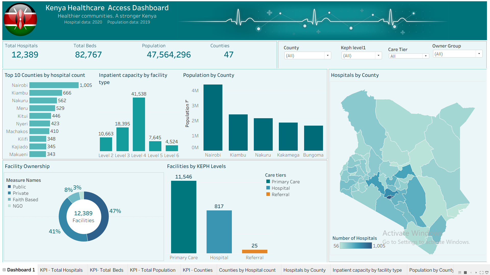

# Healthcare Access in Kenya: SQL Cleaning, EDA & Tableau Dashboard

An end-to-end analysis of how health facilities, inpatient capacity and levels of care are distributed across Kenya's 47 counties. Raw facility and census data were cleaned and explored in **MySQL**, then visualised in **Tableau**.

## Project Goal

Understand where Kenyans have good, and poor, access to healthcare, and how reliable the underlying data is. The analysis is organised around seven objectives:

1. Facility availability by county
2. Inpatient capacity (beds and cots)
3. Level of care (KEPH levels)
4. Ownership mix (public, private, faith-based, NGO)
5. Opening hours and service availability
6. Operational status
7. Data quality as a finding

## Data Sources

| Dataset | Description | Table |
|---|---|---|
| KMHFL facility list (2020) | Kenya Master Health Facility List: facility code, KEPH level, owner, beds and cots, county, opening hours, operational status | `kmhfl_hospitals_2020` |
| KNBS county population (2019) | Population, land area and density per county from the 2019 census | `knbs_county_population_2019` |

## Tools

MySQL 8 (MySQL Workbench) · SQL (CTEs, window functions, views, stored functions) · Tableau Desktop

## Repository Structure

```
health-access-kenya/
├── sql/
│   ├── health_access_db.sql        # Creates the database and source tables
│   ├── health_access_cleaning.sql  # Staging tables and data cleaning
│   ├── health_access_eda.sql       # Exploratory queries for the 7 objectives
│   └── healthaccess_eda_v.sql      # Analysis views (v_facility, v_county_access, v_quality) and EDA queries built on them
├── tableau/
│   └── kenya_healthcare_access.twbx
└── README.md
```

## Methodology

**1. Staging.** Raw tables are copied into `stg_*_raw` tables so the originals are never modified. Cleaning happens in `stg_hospitals_clean` and `stg_county_population_clean`.

**2. Cleaning** (`health_access_cleaning.sql`)
- Checked for exact duplicate rows and duplicate county names.
- Trimmed whitespace on all text columns; standardised names with custom `title_case` / `INITCAP` functions.
- Removed the national "Kenya" total row from the population table, leaving 47 counties.
- Converted placeholder values (`''`, `none`, `na`, `null`) to proper `NULL`s.
- Dropped `service_names`, which was 100% empty.
- Retained records that shared facility details but had different capacity or schedule values, because there is no timestamp or version field to decide which is current.
- Re-inserted Kenyatta National Hospital (code 13023), which was dropped by the Workbench import wizard.

**3. Views** (`healthaccess_eda_v.sql`)
- `v_facility`: one clean row per facility, with flags normalised to 1/0, bed counts parsed to numbers, KEPH level mapped to a care tier (Primary care / Hospital / Referral), owner type grouped, and data-quality flags.
- `v_county_access`: one row per county (47 rows) with access metrics.
- `v_quality`: data-quality issues in long format (issue, rows affected, % of facilities).

**4. EDA** (`health_access_eda.sql`, `healthaccess_eda_v.sql`). Per-capita and per-area facility rates, county rankings, referral gaps, ownership vs. bed share, 24-hour availability, and a data-quality scorecard.

## Key Findings

- The 5 best-served counties average **43.78 facilities per 100,000 people**, compared with **16.9** in the 5 least-served, about a **2.6-fold gap**.

*Add further findings here from your dashboard and query results, for example bed share by ownership group, counties with no Level 5 or 6 facility, and the share of facilities open 24 hours.*

## Tableau Dashboard

`tableau/kenya_healthcare_access.twbx` contains two dashboards built from these worksheets: KPIs (total hospitals, total beds, total population, number of counties), hospitals by county, population by county (top 5), facility ownership (including a donut chart), facilities across KEPH levels, and inpatient capacity by facility type.

> **Note:** The workbook reads from CSV exports of the cleaned data (for example `health_access_v_facility.csv`). If Tableau reports missing files when you open it, use **Data → Edit Data Source** and point it to your local copies of the CSVs.

*Add a dashboard screenshot here: 


## How to Reproduce

1. Install MySQL 8+ and MySQL Workbench.
2. Run `sql/health_access_db.sql` to create the database and tables.
3. Load the raw data into the two tables with Workbench's **Table Data Import Wizard**. The raw CSVs are not included in this repo; download them from the sources above.
4. Run `sql/health_access_cleaning.sql`, then `sql/healthaccess_eda_v.sql` (this creates the views), then `sql/health_access_eda.sql`.
5. Open the `.twbx` in Tableau Desktop (or Tableau Public).

## Limitations

- The facility list has no timestamp or version field, so conflicting duplicate records could not be resolved and were retained.
- Facility counts do not reflect facility size or staffing; a county with many small dispensaries may look better served than it is.
- County boundaries and population come from 2019, while the facility list is from 2020.

## Author

**Gertrude Teresia**

[](https://www.linkedin.com/in/gertrude-teresia-52b431237)